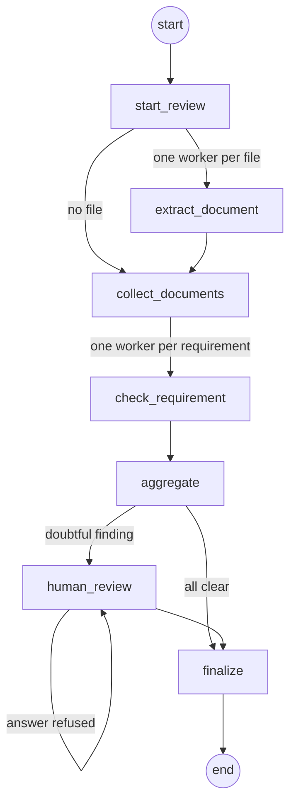

# Tender completeness review

A LangGraph workflow that checks whether a tender application contains every required document, with a Django API and an Angular interface around it.

The workflow reads the submitted files, checks each requirement of a checklist against them, quotes the passage that proves each document, pauses on doubtful cases for a human decision, and writes a report with a verdict. A paused review survives a restart of the service.

This is a demonstration built with synthetic documents. It checks that a document is there and relates to the requirement. It does not verify that a document is authentic or legally valid.

## What the workflow does



- Parallel workers with `Send`: one per file for extraction, one per requirement for the check. Their outputs go to append reducers.
- Structured outputs with Pydantic for every model call.
- Evidence validated by code: a finding is present only when the quoted passage exists in the named file. Otherwise it becomes doubtful.
- Rules before the model: no file means missing, an unreadable file means doubtful, a truncated file cannot produce a final missing.
- Human in the loop with `interrupt()`. An invalid answer routes back to the same node, which pauses again with the error.
- Verdict and report computed by code from the resolved findings. The model only writes an optional summary.
- PostgreSQL checkpoints with an explicit allowlist of state types. One review equals one thread.
- Optional Langfuse tracing, enabled when the keys are present.

The design is explained in [docs/03-technical-specification.md](docs/03-technical-specification.md).

## Example

Application with a registration extract older than three months and an insurance certificate for the previous year:

```
DC1         present   dc1_application_letter.txt
            evidence: "The candidate applies for lot 2 and declares that it is not subject to any exclusion..."
DC2         present   dc2_candidate_declaration.txt
            evidence: "Turnover of the last three financial years: 2023: 2,350,000 EUR ..."
KBIS        doubtful  kbis_extract.txt
            evidence: "Extract issued on 3 March 2026"
INSURANCE   doubtful  insurance_certificate.txt
            evidence: "...for the period from 1 January 2025 to 31 December 2025."
REFERENCES  missing
```

The review pauses on KBIS and INSURANCE. After the reviewer answers "missing" for both, the verdict is incomplete and the report lists the missing documents with the reviewer's comments.

## Results on the evaluation set

Twenty synthetic applications, one hundred requirement checks, run with Claude on 17 November 2026. Full results and the dataset are in [backend/evaluation](backend/evaluation/README.md).

| Measure | Result |
|---|---|
| Technical errors | 0 / 20 |
| Finding status within the accepted statuses | 100 / 100 |
| False present | 0 / 28 |
| Missed mandatory missing | 0 / 14 |
| Verdict correct after the reference decisions | 20 / 20 |
| Applications paused for human review | 9 / 20 |

The dataset is small. Read the raw numbers, not percentages.

## Run it

Requirements: Docker with Compose, and an Anthropic API key.

```bash
cp .env.example .env        # then set ANTHROPIC_API_KEY
make up
```

- Interface: http://localhost:4210
- API: http://localhost:8010/api/reviews/

Create a review, give the candidate a name, upload the files of `backend/examples/incomplete_application`, and watch the review pause for your decision. Ports and credentials are set in `.env`.

Without Docker:

```bash
make db            # PostgreSQL only
make install
make migrate checklists
make backend-dev   # API on port 8010
make frontend-dev  # interface on port 4210
```

From the command line, without the API:

```bash
cd backend
uv run python -m scripts.run_review examples/incomplete_application
```

An open-source model can be used through Ollama by setting `LLM_PROVIDER=ollama`. The provider is implemented and the tests cover the workflow with a model double. The evaluation results above were obtained with Claude only.

## Tests

```bash
make test       # unit and API tests, no network
make test-all   # adds the PostgreSQL tests: resume after a process restart, concurrent resumes
make lint
```

The tests use a deterministic model double. The pause and resume across two processes and the row lock against concurrent resumes run against PostgreSQL and are part of the CI.

## Project layout

```
backend/agent/        the LangGraph workflow, independent from Django
backend/reviews/      Django app: models, API, execution and recovery
backend/evaluation/   labelled dataset, runner, results
backend/scripts/      command line runner, durable resume and concurrency checks
frontend/             Angular interface
docs/                 expression of need, specifications, mockups
```

## API

| Method | Path | Purpose |
|---|---|---|
| GET | /api/checklists/ | Available checklists |
| GET | /api/reviews/ | List the reviews |
| POST | /api/reviews/ | Create a review with files and start it |
| GET | /api/reviews/{id}/ | Status, findings, evidence, verdict, report |
| GET | /api/reviews/{id}/files/{file_id}/download/ | A submitted file |
| POST | /api/reviews/{id}/decisions/ | Send the reviewer decisions and resume |

## Operations

The workflow runs in a background thread of the API. If the service stops during a review, the review stays "running". After a restart, and before accepting new reviews, run:

```bash
docker compose exec backend uv run python manage.py recover_reviews
```

The command reconciles each stuck review with its checkpoint: restart, restore the pause, store the finished result, or continue. Decisions accepted before a crash are sent again automatically.

## Documentation

- [Expression of need](docs/01-expression-of-need.md)
- [Functional specification](docs/02-functional-specification.md) with the acceptance scenarios
- [Technical specification](docs/03-technical-specification.md)
- [Mockups](docs/04-mockups.md)
- [Evaluation](backend/evaluation/README.md)
- [Changelog](CHANGELOG.md)

## License

MIT. See [LICENSE](LICENSE).
