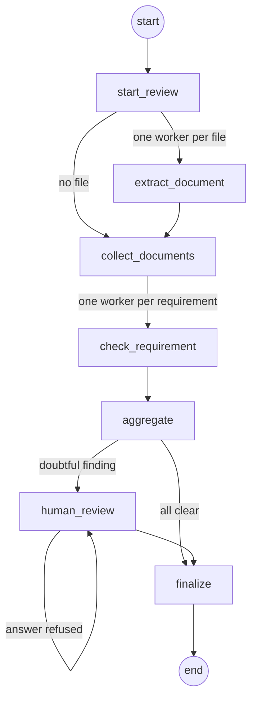
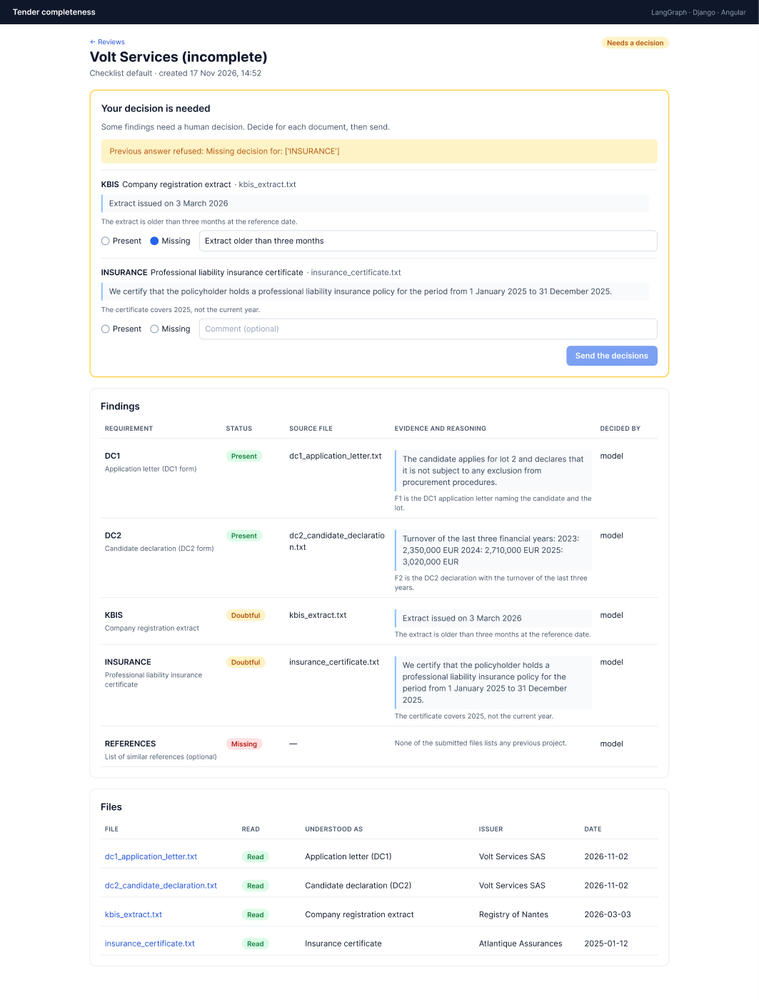

# Tender completeness review

A LangGraph workflow that checks whether a tender application contains every required document, with a Django API and an Angular interface around it.

The workflow reads the submitted files, checks each requirement of a checklist against them, quotes the passage that proves each document, pauses on doubtful cases for a human decision, and writes a report with a verdict. A paused review survives a restart of the service.

This is a demonstration built with synthetic documents. It checks that a document is there and relates to the requirement. It does not verify that a document is authentic or legally valid.

## What the workflow does



- Parallel workers with `Send`: one per file for extraction, one per requirement for the check. Their outputs go to append reducers.
- Structured outputs with Pydantic for extraction and requirement checks.
- Evidence validated by code: an automated finding is present only when the quoted passage exists in the named file. Otherwise it becomes doubtful and a reviewer decides.
- Rules before the model: no file means missing; when a file is unreadable, the requirements not established by the other files become doubtful; a truncated file cannot produce a final missing.
- Human in the loop with `interrupt()`. An invalid answer routes back to the same node, which pauses again with the error.
- Verdict and report computed by code from the resolved findings. The model only writes an optional summary.
- PostgreSQL checkpoints with an explicit allowlist of state types. One review equals one thread.
- Optional Langfuse tracing, enabled when the keys are present.

The design is explained in [docs/03-technical-specification.md](docs/03-technical-specification.md).

## Example

Application with a registration extract older than three months and an insurance certificate for the previous year:

```
DC1         present   dc1_application_letter.txt
            evidence: "The candidate applies for lot 2 and declares that it is not subject to any exclusion..."
DC2         present   dc2_candidate_declaration.txt
            evidence: "Turnover of the last three financial years: 2023: 2,350,000 EUR ..."
KBIS        doubtful  kbis_extract.txt
            evidence: "Extract issued on 3 March 2026"
INSURANCE   doubtful  insurance_certificate.txt
            evidence: "...for the period from 1 January 2025 to 31 December 2025."
REFERENCES  missing
```

The review pauses on KBIS and INSURANCE. After the reviewer answers "missing" for both, the verdict is incomplete and the report lists the missing documents with the reviewer's comments.



## Results on the evaluation set

Twenty synthetic applications, one hundred requirement checks, run with Claude on 17 November 2026. The full results, with the evidence quoted for every present finding, the decisions applied and the commit evaluated, are in [backend/evaluation](backend/evaluation/README.md).

| Measure | Result |
|---|---|
| Technical errors | 0 / 20 |
| Finding status equal to the expected status | 100 / 100 |
| Finding status within the accepted statuses | 100 / 100 |
| False present: document absent or not provable, workflow said present | 0 / 28 |
| Absent mandatory documents incorrectly marked present | 0 / 14 |
| Applications completed without human intervention, verdict correct | 12 / 12 |
| Applications paused for human review | 8 / 20 |
| Final verdict correct after the reference decisions | 20 / 20 |

Initial regression evaluation on short, largely templated English documents. These results do not establish performance on real tender applications. The numbers measure the whole workflow, rules included, not the model alone. Runs differ slightly: an earlier run of the same day answered doubtful instead of missing on one optional requirement and paused 9 applications.

## Run it

Requirements: Docker with Compose, and an Anthropic API key.

```bash
cp .env.example .env        # then set ANTHROPIC_API_KEY
make up
```

- Interface: http://localhost:4210
- API: http://localhost:8010/api/reviews/

Create a review, give the candidate a name, upload the files of `backend/examples/incomplete_application`, and watch the review pause for your decision. Ports and credentials are set in `.env`.

Run the application locally, with PostgreSQL in Docker. Requirements: Python 3.12, uv, Node 24.

```bash
make db            # PostgreSQL only
make install
make migrate checklists
make backend-dev   # API on port 8010
make frontend-dev  # interface on port 4210
```

From the command line, without the API:

```bash
cd backend
uv run python -m scripts.run_review examples/incomplete_application
```

An open-source model can be used through Ollama by setting `LLM_PROVIDER=ollama`. The provider is implemented and the tests cover the workflow with a model double. The evaluation results above were obtained with Claude only.

## Open the graph in LangGraph Studio

The workflow also runs on the LangGraph Agent Server, which gives the graph view, step by step execution and thread inspection of LangGraph Studio.

```bash
make studio
```

The command starts the server on port 2024 and prints the Studio link. Studio runs in the browser and needs a free LangSmith account. In Studio, paste the content of `backend/langgraph-studio-input.example.json` as input: the run pauses on the registration extract, and the Resume button with `[{"requirement_code": "KBIS", "status": "missing", "comment": "older than three months"}]` completes it. The same can be done against the server API with `POST /threads/{id}/runs/wait`.

## Tests

```bash
make test       # unit and API tests, no network
make test-all   # adds the PostgreSQL tests: resume after a process restart, concurrent resumes
make lint
```

The tests use a deterministic model double. The pause and resume across two processes and the row lock against concurrent resumes run against PostgreSQL and are part of the CI.

## Project layout

```
backend/agent/        the LangGraph workflow, independent from Django
backend/reviews/      Django app: models, API, execution and recovery
backend/evaluation/   labelled dataset, runner, results
backend/scripts/      command line runner, durable resume and concurrency checks
frontend/             Angular interface
docs/                 expression of need, specifications, mockups
```

## API

| Method | Path | Purpose |
|---|---|---|
| GET | /api/checklists/ | Available checklists |
| GET | /api/reviews/ | List the reviews |
| POST | /api/reviews/ | Create a review with files and start it |
| GET | /api/reviews/{id}/ | Status, findings, evidence, verdict, report |
| GET | /api/reviews/{id}/files/{file_id}/download/ | A submitted file |
| POST | /api/reviews/{id}/decisions/ | Send the reviewer decisions and resume |

## Operations

The workflow runs in a background thread of the API. If the service stops during a review, the review stays "running". After a restart, and before accepting new reviews, run:

```bash
docker compose exec backend uv run python manage.py recover_reviews
```

The command reconciles each stuck review with its checkpoint: restart, restore the pause, store the finished result, or continue. Decisions accepted before a crash are sent again automatically.

## Limits

- No OCR: a scanned document without a text layer is reported unreadable and its requirements go to the reviewer.
- Each file is given to the check worker up to a character budget. A longer file is marked truncated and cannot produce a final missing, which raises the number of human reviews on long applications.
- The evidence check proves that a quote comes from the file. Whether the quote establishes the requirement was measured on a few cases only.
- The demonstration runs locally, without authentication. The deployment guide adds TLS and a reverse proxy, not user accounts.

## Deployment

A guide for Scaleway is in [docs/05-deployment-scaleway.md](docs/05-deployment-scaleway.md). It uses the same Docker Compose stack on an Instance, with a managed PostgreSQL database and a reverse proxy for TLS. The stack was verified locally; the Scaleway steps are written from the provider's documentation and were not executed as part of this repository.

## Documentation

- [Expression of need](docs/01-expression-of-need.md)
- [Functional specification](docs/02-functional-specification.md) with the acceptance scenarios
- [Technical specification](docs/03-technical-specification.md)
- [Mockups](docs/04-mockups.md)
- [Deployment on Scaleway](docs/05-deployment-scaleway.md)
- [Evaluation](backend/evaluation/README.md)
- [Changelog](CHANGELOG.md)

## License

MIT. See [LICENSE](LICENSE).
