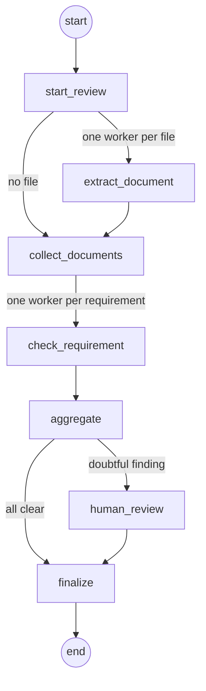

# Technical specification

## Architecture

```
Angular (frontend)  ->  Django REST API (backend)  ->  LangGraph workflow (backend/agent)
                                 |                              |
                            PostgreSQL  <-- checkpoints --------+
```

- The workflow lives in `backend/agent` and has no dependency on Django. It can run from the command line.
- Django stores the reviews, the files and the results, exposes the REST API, and runs the workflow.
- LangGraph stores its checkpoints in the same PostgreSQL database. The review identifier is the thread identifier.
- The chat model is Claude through the Anthropic API. An Ollama provider is implemented for open-source models.

## Workflow



State fields:

| Field | Type | Written by |
|---|---|---|
| review_id | str | input |
| required_documents | list[RequiredDocument] | input |
| submitted_files | list[SubmittedFile] | input |
| extracted_documents | list[ExtractedDocument], append reducer | extract_document workers |
| findings | list[Finding], append reducer | check_requirement workers |
| human_decisions | list[HumanDecision] | human_review |
| review_error | str | human_review, when the answer is refused |
| resolved_findings | list[Finding] | finalize |
| verdict | complete or incomplete | finalize |
| report | Markdown string | finalize |
| status | str | every node |

Workers receive their own payload through `Send`, not the whole state. Their outputs go to append reducers so parallel writes never conflict.

## Evidence validation

The check worker receives the source text of each readable file, with a stable identifier and a character budget per file. The model returns the file identifier and a quote. The code then checks that the identifier exists and that the quote appears in that file after whitespace normalisation. A finding is present only when both checks pass. Otherwise it becomes doubtful with the reason.

A file longer than the budget is marked truncated in the prompt. A "missing" answer cannot become final when a truncated file exists: the finding becomes doubtful and names the file.

This validation proves that the quote comes from the file. It does not prove that the quote establishes the requirement. The prompt asks for a passage that proves the requirement, not one that mentions it, and the evaluation set measures how often the model gets this wrong.

## Human review

The `human_review` node calls `interrupt()` once with the doubtful findings. The node has no side effect before the interrupt, so it can be re-executed on resume. The resume value is validated: one decision per doubtful finding, no unknown code, no duplicate. An invalid value is written to `review_error` and a conditional edge brings the graph back to `human_review`, which pauses again with the error in its payload. The API validates the decisions with the same function before resuming, and stores them on the review before the workflow runs.

## Failure handling

- A file with no text is unreadable. It is a document problem, reported in the findings.
- A model error during extraction or check is a technical problem. The node retry policy retries it three times, then the review fails with the error. The optional summary has no retry: when it fails, the report is produced without it.
- Parallel workers are bounded with `max_concurrency`.
- A review that fails is marked failed with the error message.
- If the service stops while a review is running, the review row stays "running". The `recover_reviews` command reconciles such reviews with their checkpoint: no checkpoint means restart from the stored inputs, a pause means restore the waiting status, a finished checkpoint means store the result, a checkpoint in the middle means continue the workflow. Run it after a restart, when no worker is active.

## API

| Method | Path | Purpose |
|---|---|---|
| GET | /api/checklists/ | List the available checklists |
| GET | /api/reviews/ | List the reviews |
| POST | /api/reviews/ | Create a review with files and start it |
| GET | /api/reviews/{id}/ | Status, findings, evidence, verdict, report |
| GET | /api/reviews/{id}/files/{file_id}/download/ | The submitted file |
| POST | /api/reviews/{id}/decisions/ | Send the reviewer decisions and resume |

The workflow runs in a background thread. The review row is locked when a run or a resume starts, so two resumes cannot overlap. The requirements are copied on the review at creation: a later change of the checklist does not alter past reviews.

## Checkpoint serialization

The state holds Pydantic models. The checkpointer uses a serializer with an explicit allowlist of these types, so they are rebuilt from PostgreSQL without warnings and nothing else can be rebuilt.

## Observability

When Langfuse keys are present, every run is traced with the review identifier as the trace name and session, and the node names appear as spans.

## Evaluation (planned)

`backend/evaluation/` will hold a small labelled dataset of applications (complete, missing, ambiguous, unreadable, negations, documents mentioned but absent) and a script that runs the workflow and reports: wrong present decisions, missed missing documents, human review rate. Results will be recorded with the model name, the date and the dataset size.
