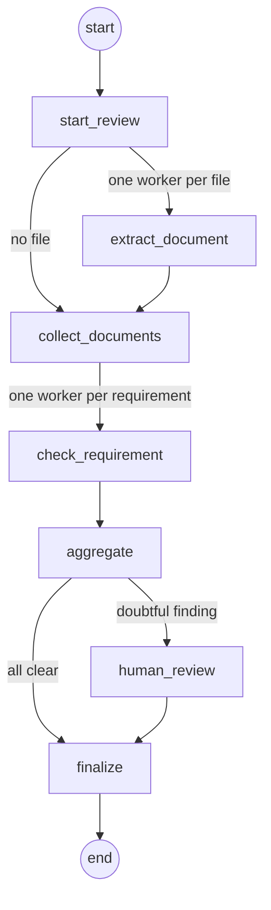

# Technical specification

## Architecture

```
Angular (frontend)  ->  Django REST API (backend)  ->  LangGraph workflow (backend/agent)
                                 |                              |
                            PostgreSQL  <-- checkpoints --------+
```

- The workflow lives in `backend/agent` and has no dependency on Django. It can run from the command line.
- Django stores the reviews, the files and the results, exposes the REST API, and runs the workflow.
- LangGraph stores its checkpoints in the same PostgreSQL database. The review identifier is the thread identifier.
- The chat model is Claude through the Anthropic API. An Ollama provider is implemented for open-source models.

## Workflow



State fields:

| Field | Type | Written by |
|---|---|---|
| review_id | str | input |
| required_documents | list[RequiredDocument] | input |
| submitted_files | list[SubmittedFile] | input |
| extracted_documents | list[ExtractedDocument], append reducer | extract_document workers |
| findings | list[Finding], append reducer | check_requirement workers |
| human_decisions | list[HumanDecision] | human_review |
| resolved_findings | list[Finding] | finalize |
| verdict | complete or incomplete | finalize |
| report | Markdown string | finalize |
| status | str | every node |

Workers receive their own payload through `Send`, not the whole state. Their outputs go to append reducers so parallel writes never conflict.

## Evidence validation

The check worker receives the source text of each readable file, with a stable identifier and a character budget per file. The model returns the file identifier and a quote. The code then checks that the identifier exists and that the quote appears in that file after whitespace normalisation. A finding is present only when both checks pass. Otherwise it becomes doubtful with the reason.

## Human review

The `human_review` node calls `interrupt()` with the doubtful findings. The node has no side effect before the interrupt, so it can be re-executed on resume. The resume value is validated: one decision per doubtful finding, no unknown code, no duplicate. An invalid value raises an error and leaves the checkpoint at the pause.

## Failure handling

- Extraction errors produce an unreadable document instead of stopping the workflow.
- Model calls use the LangGraph retry policy with a small number of attempts.
- Parallel workers are bounded with `max_concurrency`.
- A review that fails is marked failed with the error message. It can be restarted from scratch.

## API

| Method | Path | Purpose |
|---|---|---|
| GET | /api/checklists/ | List the available checklists |
| GET | /api/reviews/ | List the reviews |
| POST | /api/reviews/ | Create a review with files and start it |
| GET | /api/reviews/{id}/ | Status, findings, evidence, verdict, report |
| POST | /api/reviews/{id}/decisions/ | Send the reviewer decisions and resume |

The workflow runs in a background thread. The review row is locked when a run or a resume starts, so two resumes cannot overlap.

## Observability

When Langfuse keys are present, every run is traced with the review identifier as the trace name and session, and the node names appear as spans.

## Evaluation

`backend/evaluation/` holds a small labelled dataset of applications (complete, missing, ambiguous, unreadable) and a script that runs the workflow and reports: wrong present decisions, missed missing documents, human review rate. Results are recorded with the model name, the date and the dataset size.
