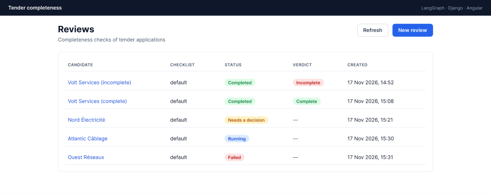
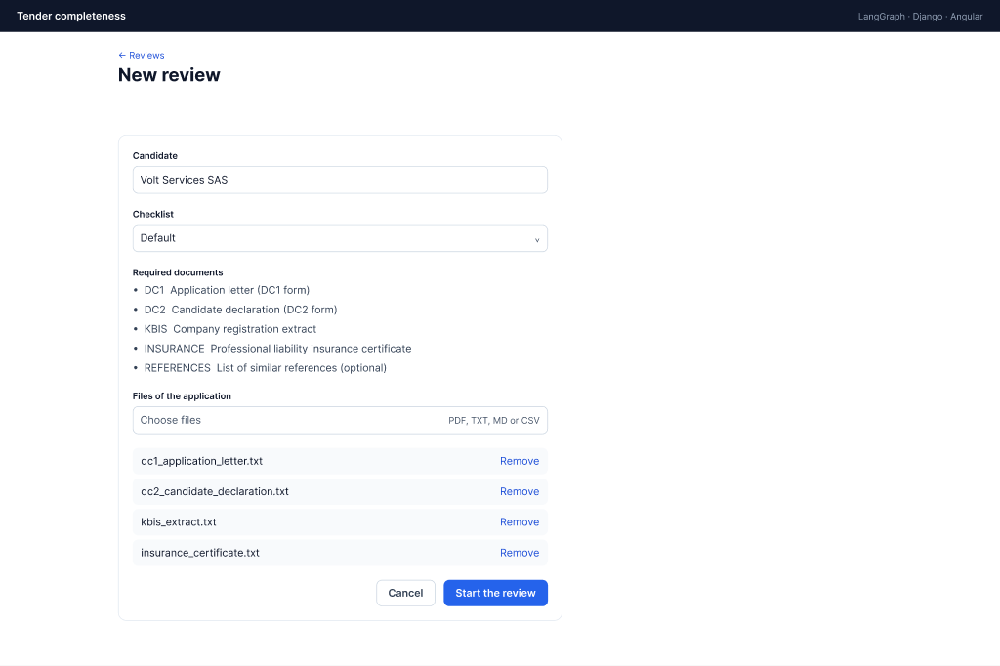
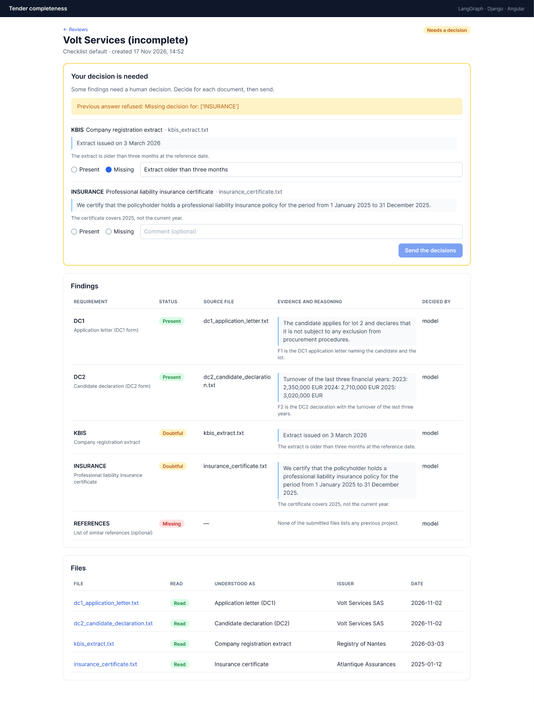
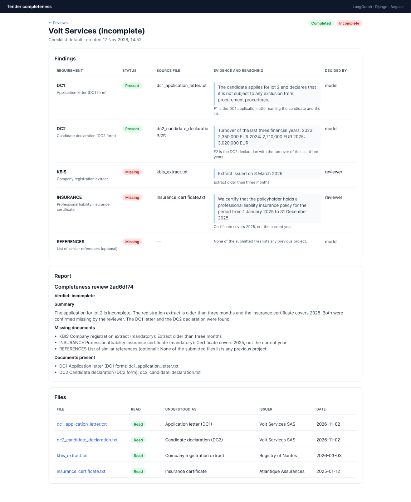

# Mockups

The Figma file documents the interface, its components and its visual tokens. It uses the same color tokens and text styles as the Angular stylesheet.

Figma file: https://www.figma.com/design/9HuvKZ2XsfNx85QXEpzhGf

## Pages of the file

- Foundations: the color variables (primary, neutral, success, warning, danger, info) and the text styles.
- Components: Button (primary, secondary, disabled), Status badge (one variant per review, finding, verdict and document status), Alert (info, warning, danger), Input (text, select, file), Top bar, Spinner.
- Screens: Reviews list (empty, loaded), New review, Review detail (running, needs a decision, completed, failed).

## Screens

Reviews list

New review

Review detail, paused on two doubtful findings

Review detail, completed

